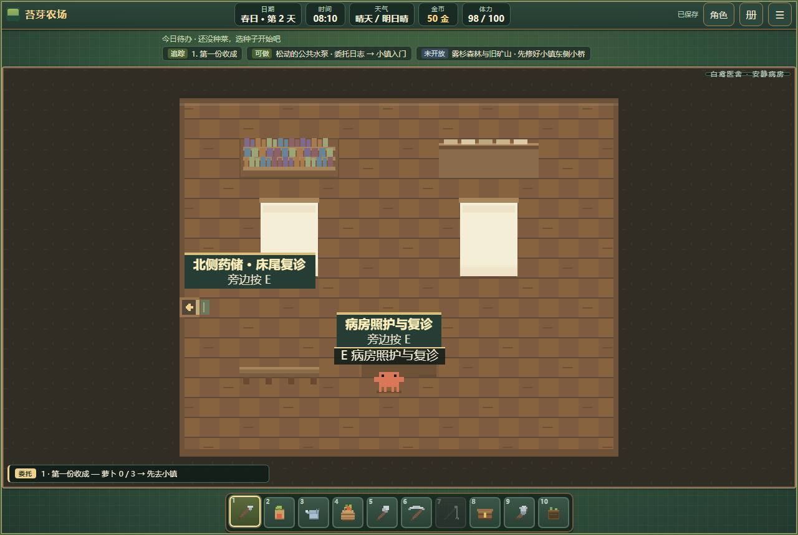
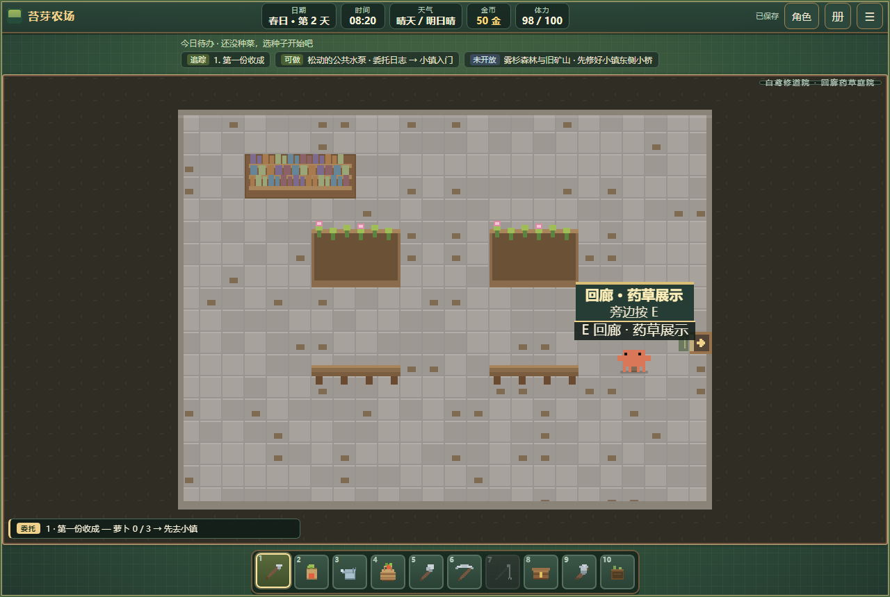

# 白鸢医舍与修道院首轮建设

2026-10-15，本地施工，尚未提交推送。

保留地区原入口、诊疗室、档案室、梅菈与奥伦。诊疗室东门通22×18安静病房，档案室西门通24×18修道院回廊；两处均有可返回的实体门、家具碰撞及去向说明。病房有两张床、北侧药品储藏和床尾记录台，回廊有药草展示与长椅。

正常路线：小镇西南入口 → 医舍地区；档案室核验样本 → 诊疗室建立病历、签收与配药 → 内侧病房照护 → 隔夜复诊。建筑导览说明各工作位置与当前病历状态。原通行条件保留。

病房共用既有职业病历、药包库存与复诊日期。照护消耗药包1、20分钟、2体力；复诊10分钟，必须到次日，只奖励一次。原诊疗台仍可处理同一记录，不另建第二名患者或重复奖励。药草庭院当前为展示与休息空间，明确说明尚不产出材料；草甸兽医保持独立。

自动验证：新增医舍流程源码22项、单文件22项；原职业流程82项、室内门19项、存档11项、单文件冒烟6项，共162项通过。覆盖四处室内门和工作位可达、原入口、实际步行往返、无病历限制、照护消耗、提前复诊拒绝、病房读档、次日复诊、重复结算与手机进门。截图来自验证中的实际病房与回廊路径。手机为浏览器触屏模拟，未进行实体设备验证。

市政与商会后续已交付，见[规划收尾](construction-completion.md)。修道院二层生活空间、药草种植和长期患者制度仍属后续玩法。
