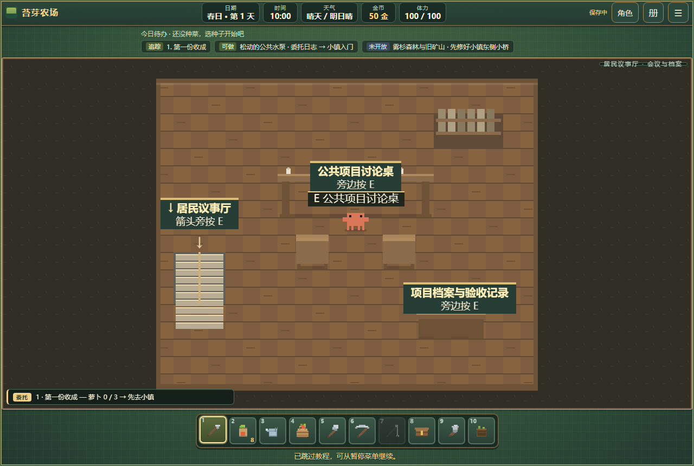
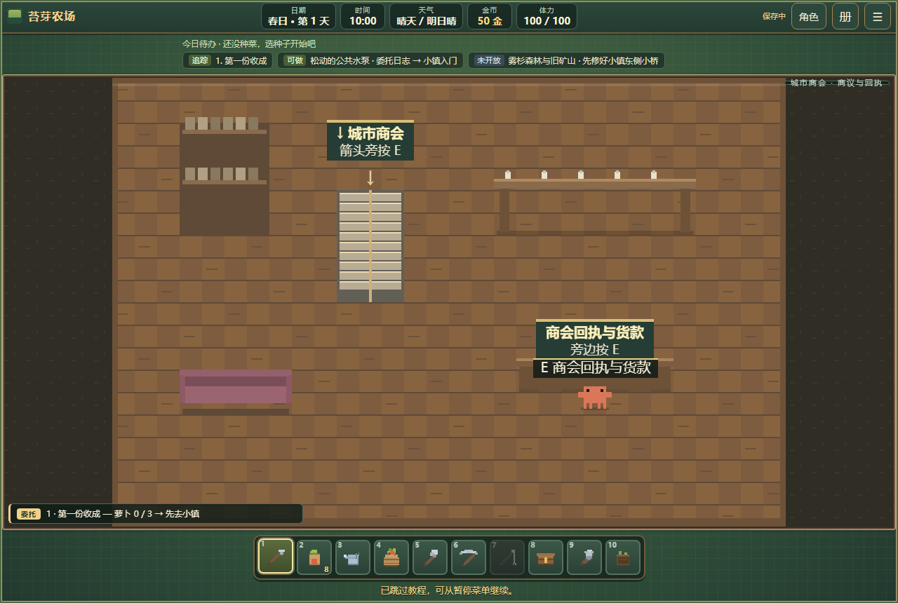
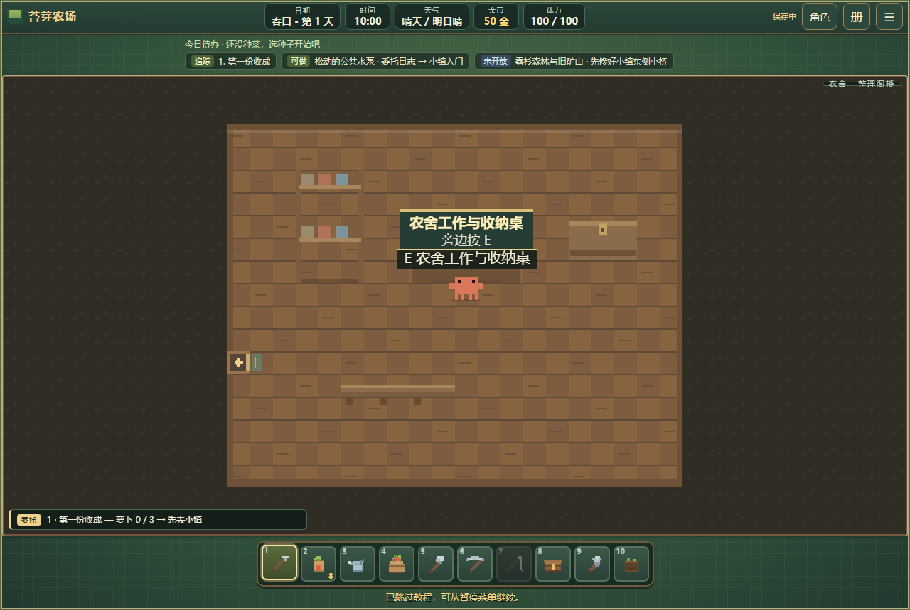
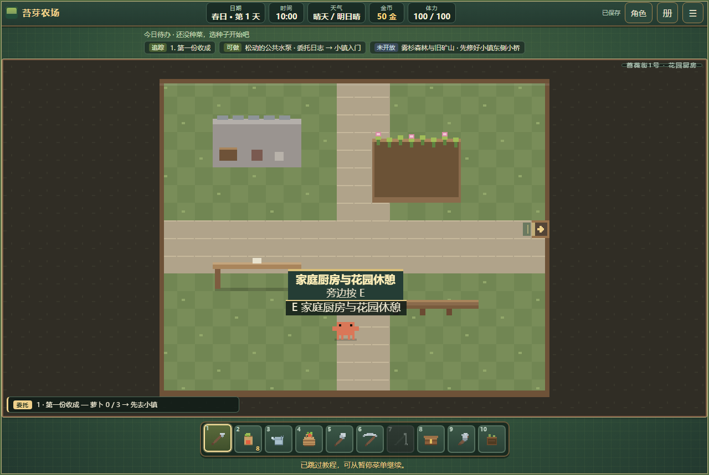
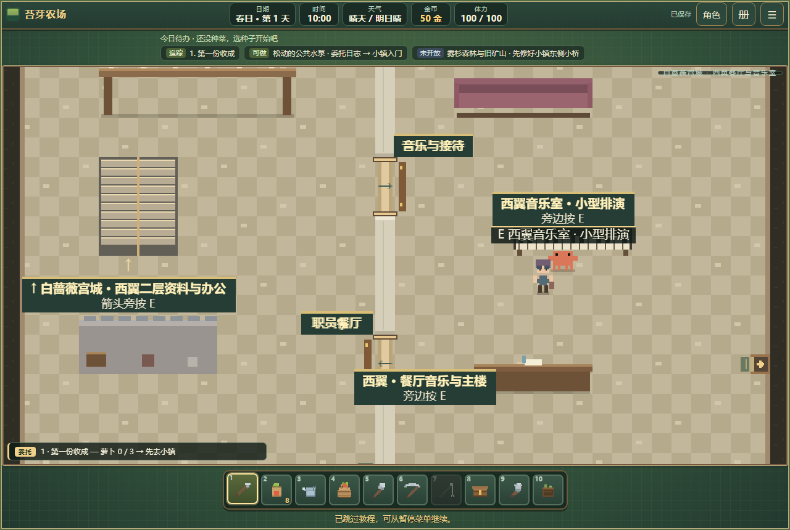
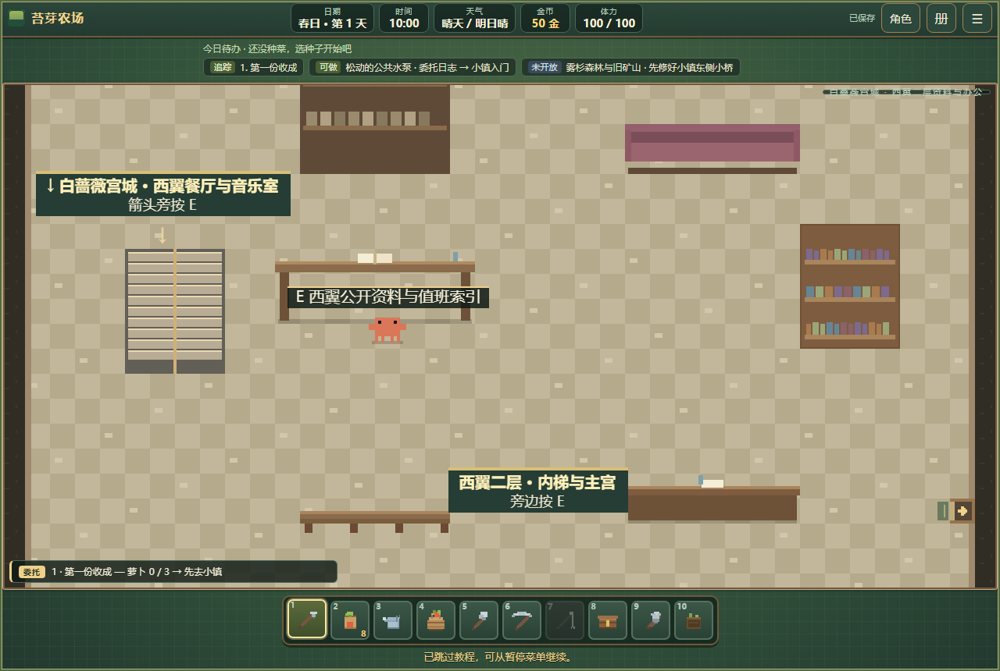
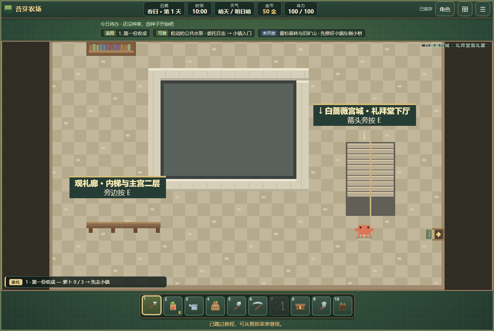
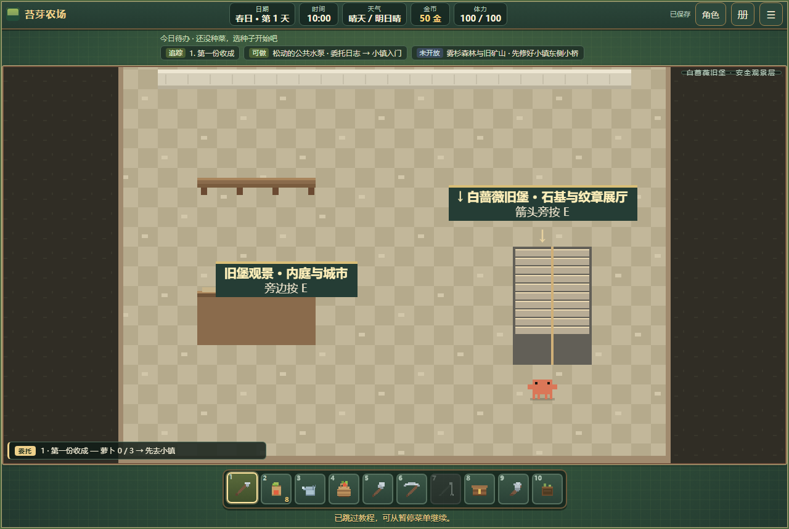

# 重点场景建设规划第一版 · 交付与复审

日期：2026-10-15。建设范围以[第一版规划](重点场景建设规划-v1.md)各期首个交付范围及[收尾施工图](construction-final-batches.md)为准。以下为本地工作区成果，尚未提交、推送或发布线上。

## 建筑组交付表

| 规划项 | 可使用的成果 | 记录 |
|---|---|---|
| 一期宫殿 | 三层主宫与18处层内房门；东翼地面、二层与地下后勤；西翼餐厅音乐室；双层礼拜堂与主宫二层连接；旧堡展厅、观景层；北花园每日维护 | [门梯](palace-wayfinding.md)、[东翼](palace-east-wing.md)、[后勤](palace-service-levels.md)、本记录 |
| 二期大学 | 校园导览，主楼与图书馆二层，查阅—观察—样本核验—报告完整研究；原课程、温室与宿舍服务保留 | [大学](university-construction.md) |
| 三期南门 | 旅馆上下层、登记客房与房内醒来，邮局侧门、车马院及分拣交接回执；原寄信和马车保留 | [南门](south-gate-construction.md) |
| 四期工业区 | 货仓、带锯、成品核验、领取或运输，船棚收货；与地区河港共用批次，原铸造、动力、锅炉与加工服务保留 | [工业区](industry-construction.md) |
| 五期医舍 | 诊疗室、安静病房、药储、档案室、回廊药草展示；同一病历照护与隔夜复诊 | [医舍](clinic-construction.md) |
| 五期公共机构 | 议事厅会议与档案二层、公共修缮项目；商会二层回执、交接院与可结算采购单 | 下文 |
| 穿插住宅 | 农舍整理阁楼；裁缝铺前店、住所和晾晒后院；蔷薇街1号会客层、卧室书房、花园厨房 | 下文 |
| 六期整体复审 | 门梯、人物、旧档、交易边界、手机模拟、原任务、多文件与单文件；城区宫苑公共入口与新空间地图归属 | 验收记录下文 |

## 议事厅与商会

居民议事厅一层办理登记与交材料，西南侧梯上二层会议、档案；榆安留在一层接待。公共长椅修缮依次登记、讨论“树荫休息／便于通行”、到原城市铁匠铺核对工法，最后交木材2、石料2验收。档案保留方案与结果，长椅显示验收标记。项目不重复扣材料、不授予政治职位。原议事服务的站位同时修正，避免长桌与座椅挡住交互。

商会原路易柜台和春日采购主线保留。新小额采购在一层东侧选择萝卜或土豆2份，东门去交接院交货，再上二层领取回执与货款。单价采用原商会收购价：基础售价乘1.3后逐份取整。接单不扣材料，交货只扣一次，回执只付款一次；每天最多结清一单，未完成跨日保留。满包仍可领取纯货款；离开工作台后旧按钮不能远程领款。

## 农舍与两栋住宅样板

农舍原门、床、灶、箱、手册不移动。西侧阶梯门通整理阁楼，工作桌可打开同一个农舍储物箱及手册。此次属于现有空间整理，不新增收费升级、第二份库存或阁楼睡眠规则。

丝带裁缝铺原前店和莉丝的岗位保留，中后部楼梯到楼上起居，东侧门通晾晒后院。蔷薇街1号新增住户艾榛，原层接待，楼上卧室书房、西门花园厨房形成生活分区。两栋住所可参观，私人物品与床不可使用，未提供陌生住宅住宿。后院采用草地与石板步道，商会交接院采用石地，与室内木地板区分。

## 宫城历史区与回访

主楼一层西门通西翼，隔断与两处真实步行门分开餐厅、厨房、音乐与职员区。乐师伊弦在音乐室，小型排演消耗10分钟，无费用和重复春宴奖励。西翼内梯上二层资料、阅读与职员办公，东门回主宫二层；两侧翼均已具备地面与二层空间。

礼拜堂从宫苑西侧进入，下厅有座席，内梯上观礼廊，东门接主宫二层西门。上层临空区域有实体栏边、封闭中庭和明确绕行回廊。旧堡下层展示石基、纹章及历史修缮索引，上层安全观景，不按每段塔身复制空楼层。

北花园园丁苔林与两侧维护牌提供持续回访：花草整理20分钟、3体力；石座维护消耗石料1、15分钟、2体力。各自每天只登记一次，未完成不冒记日期。三层客房及私人会客陈设明确说明参观边界，实际住宿仍在南门旅馆办理。

## 地图、保存与验收

14处收尾新增空间均有稳定场景身份。建设事务集中保存在一个 `construction` 记录中，旧档自动补空记录，损坏阶段、货品与未来日期不会伪造验收。原任务、关系、物品和房屋设施继续保存。

阁楼打开地图归属农场，医舍室内归属医舍，宫城各层归属城市及唯一宫城交通节点。城区图只有一个宫苑公共入口按钮；需要城市通行和首次到访，落点为宫苑安全主路，城内耗时0，不把玩家传到寝居或楼层内部。

新增完整路径：源码74项、单文件74项通过；最终存档与边界：源码32项、单文件32项通过。覆盖实际步行、成对楼梯、不弹回、院内交货、缺材料、满包、重复操作、跨日读档、维护日期与地图条件。西翼二层另由最终边界套件验证上下梯与返回主宫。本文最终版面图以 `capture-construction.mjs` 的固定站位与状态统一拍摄；它们展示布局，不冒充正常流程完成证据。

原建筑组及系统回归分别保存在 `output/construction-review/`。原农场主线已正常推进至第14天，123项通过；地图20项、交通56项在地图修正后再次通过。具体各组最终结果见同目录 `palace.json`、`public.json`、`system.json`。单文件和站点产物可本地打开，外部依赖检查无网络外链。

分组复审共21个套件全部通过：宫殿7组，公共建筑及职业6组，门、存档、地图、交通、屏幕布局、R2和离线冒烟8组。另将旧宫殿楼层测试的露台出口类型按既有门配置修正为 `indoorExit`，匹配具体 `doorId`，不再把正确出口误记为契约警告。

手机为390×844及既有横屏尺寸的浏览器触屏模拟，未进行实体手机验收。本次不以模拟结果冒充实体设备性能。

本机无头Chromium的西翼场景各采样120帧：1280×860视口的动画帧间隔中位数16.7毫秒、95分位16.7毫秒；390×844触屏模拟分别为16.7与16.8毫秒。房间缓存为608×416像素，RGBA理论字节数1,011,712。原始记录在 `output/construction-review/render.json`；这些是本机动画帧观察，不等同实体手机性能或独立渲染耗时测量。

## 原规划中另行落实的长期系统

建筑首个交付范围已完成。以下属于原文明确写作后续或另行落实的玩法，不是此次留下的断门、空按钮或半条事务：长期学制与导师、宿舍长期入住、买马寄养与完整邮政、工厂雇佣和航线经营、长期患者、家庭与收费房屋升级、金融政治权限、向全部城市住宅推广。相关原有服务继续保留，新增入口不宣称已提供这些能力。
