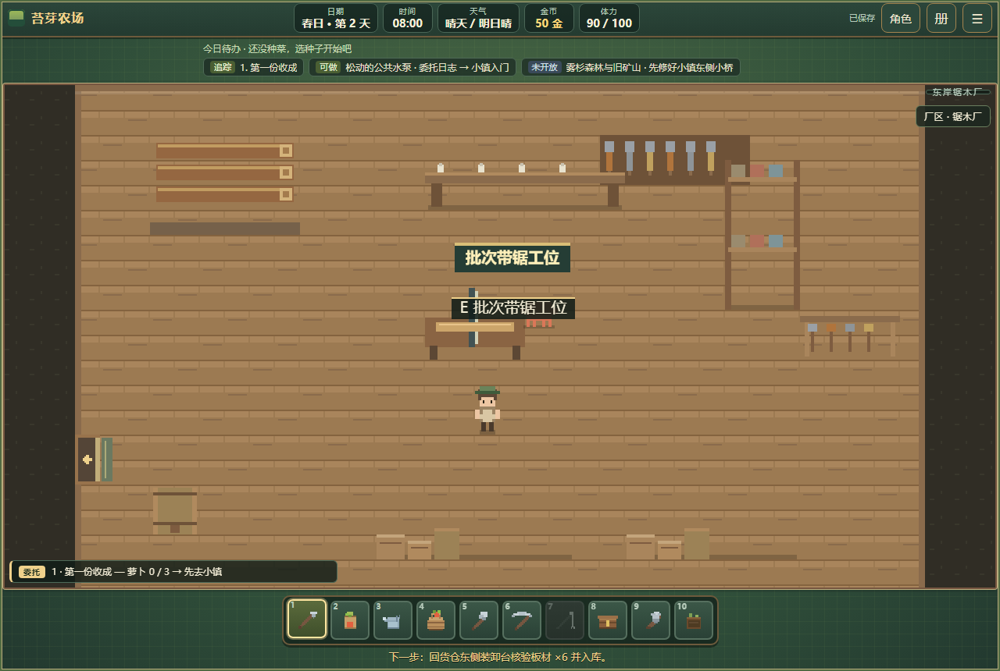

# 河港工业区首轮建设记录

2026-10-15，本地施工完成，尚未提交推送。

城市货仓、锯木厂增加成对装卸侧门与厂区导览。锯木厂使用原木进料台、带锯工作台，船具棚设板材收货位。城市工业码头与下游地区河港仍是两处地点。

货仓登记木材2 → 锯木厂60分钟、10体力细剖板材6 → 货仓核验。随后可取回自用、送本地船棚，或满足河港通行与核单条件后转下游船务屋装船再签收。待发水运可以调回。交货按原代销价共234金结算，真实运输计一次商旅经历；自用取回不计货款或运输经历。每日最多结清一批，未完批次跨日保留。

任务货物只在一份工业批次账中保管，取回才进背包；满包不吞货。旧地区运单未结清时不能受理新水运，工业运输不会消耗或复制旧运单。水运沿用既有验收后用水方案的耗时规则。

验收：工业流程源码54项、单文件54项；原室内门19项、地区职业复审82项、存档11项、单文件冒烟6项通过，城市服务无失败。覆盖真实步行、手机交互、跨日读档、满包、重复奖励、两地运输及原运单隔离。

锯木厂图来自实际流程；货仓、厂院与船务屋图使用固定站位与批次状态查看布局。

下一批白鸢医舍与修道院已开始施工；完整工厂雇佣、航线经营与各车间扩建仍在后续规划中。
