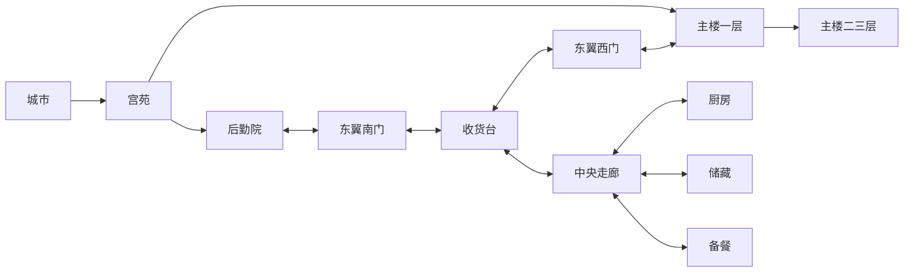

# 宫殿东翼地面层 · 接手施工与验收

日期：2026-10-14。依据：[重点场景建设规划](重点场景建设规划-v1.md)建设一期。

后续更新：地下后勤与东翼二层已在下一施工批次接入，服务梯及日常备餐见[后勤楼层建设记录](palace-service-levels.md)。下文保留地面层接手时的验收范围与历史状态。

## 接手时的进度

远端 main 为 `31138f8`：R2、R3 首轮内容与宫殿 P1 三层骨架已提交。工作区另有主楼楼梯、十八处房门和建设规划，尚未提交；东翼新增布局也未收尾。此处只说明核对到的提交范围，不代表全部职业与地区已完成。

东翼接手时已有 36×24 格室内、两道出口和厨房等家具；存在外部门牌仍锁闭、立面门与入口位置不同、六处室内交互未登记、办公及休息区八格被家具隔断、单文件产物落后等问题。

本批保留上述布局与主楼通路成果，完成东翼地面层通行、料理制作及现有春宴委托交付。地下后勤、服务梯、侧翼上层、旧堡及宫苑礼拜堂仍未开放。

## 平面与路线

中央走廊连接两侧房间；房门有名称并可步行穿过。桌椅留出边侧通道。

| 方位 | 西侧 | 中央 | 东侧 |
|---|---|---|---|
| 北段 | 储藏与备用工具 | 职员办公室，留侧边通道 | 厨房与备料 |
| 中段 | 横向通道与长凳 | 南北通道 | 餐厅通道与长凳 |
| 南段 | 春宴收货台；西门通主楼一层 | 侍从休息，留通道 | 餐厅备餐 |
| 南墙 | 南门位于收货区，通后勤院北侧 | — | — |

地面层通行不经过王座厅。后勤院向北出院门，东翼南门就在前方。主楼一层东墙门也能进入侧翼。东翼显示“东翼 · 地面层”的导览入口，主楼三层编号保持不变。

## 可使用的内容

- 收货台打开塞琳现有“为蔷薇园备下春宴”委托，沿用春日采购前置、草莓两份与木料五份、原奖励和完成状态。
- 主楼门厅保留原办理入口；两个柜台共用同一个委托，完成后只显示记录，不再次发奖。
- 厨房炉灶打开既有料理制作界面，沿用配方解锁、材料、背包空间与制作规则。
- 储藏、职员办公、休息和备餐为可阅读的环境说明。本批没有独立排班、库存调拨或宴会生产系统。
- 后勤院标牌说明实际入口和路线；未施工区域保留关闭反馈。回廊说明改为实际返回二层再上三层的路线；露台园艺委托明确为未开放。

## 验收与证据

专项用例：[run-palace-east-wing.mjs](../tests/run-palace-east-wing.mjs)。初始城市许可、前置委托与材料使用夹具；室内走路、门口交互、接受和交付、料理入口、继续游戏及手机按钮由真实输入验证。此用例不代表从新档完成整个城市前置故事。

验收包括所有可走地面及六处交互站位连通、后勤院进入、侧翼与主楼往返、材料不足处理、唯一奖励结算、料理入口、侧翼读档和手机触屏。配套复查主楼布局、楼层、旧档、手机及单文件冒烟。

本轮验证共 323 项通过：东翼 29、布局 109、旧档 25、源码与打包楼层通行 82、手机导航 32、主楼房门与楼梯 40、单文件冒烟 6。楼层用例保留两条既有警告：三层露台通道使用 indoorExit，而旧契约写为 indoorEntrance；实际往返通过。

证据图：[东翼室内](../output/playwright/palace-east-wing.png)。专项已加入本地统一验证入口和仓库验证工作流。模拟手机结果不代表实体设备性能验收。

## 后续施工

宫殿下一批先设计侧翼上层或地下后勤的用途、平面及成对服务梯，再施工；开放前补对应玩法和存档验收。大学建设二期可开始盘点学院、图书馆和温室，绘制校园首批通路图。

本批结果为本地工作区内容；提交、推送与线上发布分别确认。
