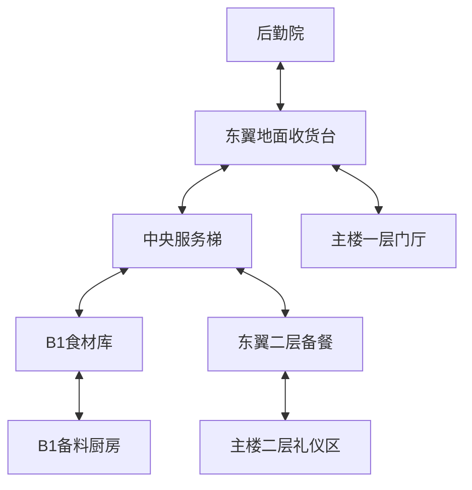
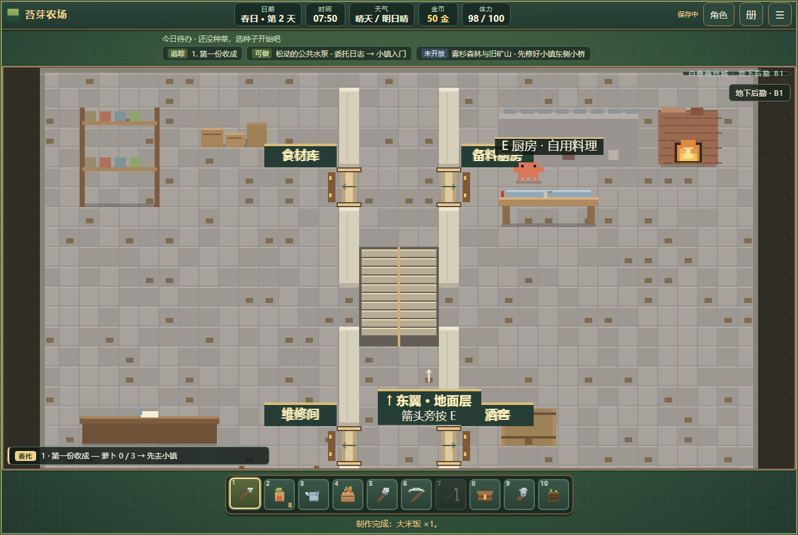
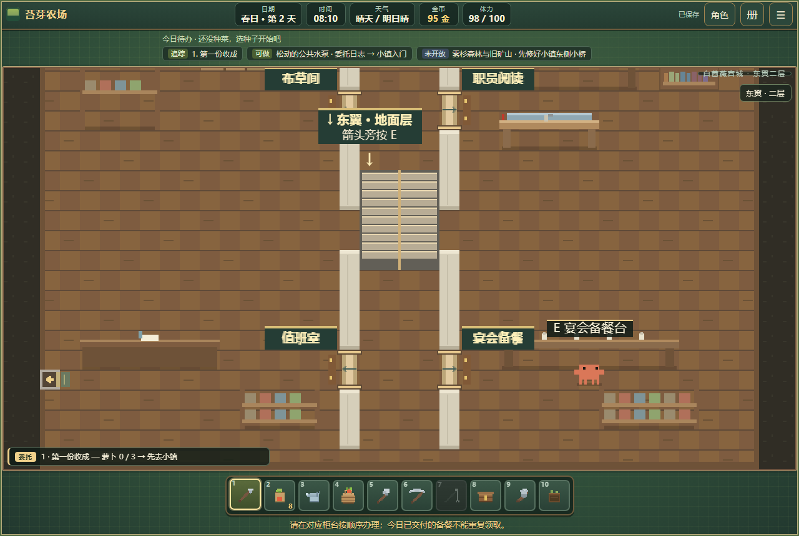

# 宫殿东翼二层与地下后勤 · 建设记录

日期：2026-10-14。承接[东翼地面层](palace-east-wing.md)及[重点场景建设规划](重点场景建设规划-v1.md)建设一期。

## 本批开放范围

新增地下后勤 B1、东翼二层，均为 36×24 格的连续室内；地面层沿用原收货与厨房布局。主楼仍为三层，东翼单独标注所在层，不占用或改名主楼楼层。

| 楼层 | 西北 | 东北 | 西南 | 东南 | 返回方式 |
|---|---|---|---|---|---|
| B1 地下 | 食材库、入库登记 | 备料厨房、自用料理 | 维修工具间 | 酒窖储藏 | 中央服务梯上地面层 |
| 东翼地面 | 储藏 | 厨房 | 收货台 | 餐厅备餐 | 西门回主楼一层；南门回后勤院 |
| 东翼二层 | 布草与餐具 | 职员阅读 | 值班室 | 宴会备餐台 | 服务梯下地面层；西门回主楼二层 |

食材登记、备料和二层交餐有真实操作；维修、酒窖、布草、阅读和值班室目前提供环境说明，未开放对应加工或职业任务。

## 门与楼梯施工

服务梯在三个后勤层的同一位置：中央走廊 `x=16..19, y=9..13`，北侧 `(16,8)` 为下行平台，南侧 `(19,15)` 为上行平台。实际连接共四段：B1 上地面、地面下 B1、地面上二层、二层下地面。两端楼层只显示实际可用方向。

上行落点 `(19,6)`、下行落点 `(17,14)` 与反向触发平台至少相隔三格，避免连按反弹。梯段、箭头、目的楼层与电脑／手机操作提示一并绘制。楼梯靠交互换层，走过普通梯段不会自动切换。

地下层四周为完整外墙，仅通过服务梯进出。通用室内验收增加对这种空间的检查：入口可走、平台可达、目的落点安全、反向楼梯存在。地下导航指向实际上楼平台。

二层新增主楼东墙门 `(63,19)` 与东翼西门 `(0,19)`，原二层画廊门保持可用。旧主楼服务梯段继续封闭，牌子明确提示使用东翼服务梯；没有把旧梯段直接接到不对齐的地下坐标。

宫内导览列出后勤各层用途和备餐下一步；后勤院指路牌、门厅及原备餐间说明同步更新。

## 可反复的后勤备餐

开放条件：完成塞琳的原“为蔷薇园备下春宴”，并解锁既有土豆料理配方。原春宴前置、奖励和已完成状态不变；后勤备餐单独保存。

| 步骤 | 操作位置 | 消耗与结果 |
|---|---|---|
| 收货领单 | 地面收货台 → 查看后勤备餐 | 土豆 ×2、5 分钟；材料进入任务保管 |
| 入库 | B1 西北食材库 | 5 分钟；将原单登记为已入库 |
| 备餐 | B1 东北后勤备料灶 `(25,5)` | 20 分钟、2 体力；在库原料转为待交付饭菜 |
| 交餐 | 东翼二层东南备餐台 | 5 分钟；获得 45 金，记录实际完成日 |

每个游戏日最多完成一单，次日可再领。未完成单可跨日继续；不会因睡觉重扣材料或要求重新领取。接收、入库、备餐和交付使用唯一阶段状态，饭菜在任务保管中，不占普通背包、不能出售。所有消耗通过现有统一行动接口校验后执行。

地下炉灶另有自用料理站位 `(24,5)`，复用原料理界面；它只使用背包材料，成品进入背包，独立于后勤单。备餐不会改变普通料理配方的解锁条件。

材料不足、体力不足、时间不足、前置未满足、错误柜台或重复操作均不推进状态、不扣费用。跨日额度按最终交付日计算，不能在同日领第二单。

## 存档与验证

`palace.provision` 保存阶段及完成日；旧宫殿存档缺少此字段时补空单。主楼 ID、旧任务与布局版本保持原值，新增场景和到访记录按实际进入登记。

专项：[run-palace-service.mjs](../tests/run-palace-service.mjs)，分别运行源码与单文件版。使用城市许可、原春宴完成、料理解锁、材料与时间体力夹具安排初始条件；实际门和楼梯、各柜台动作、跨日续办、读档、自用烹饪和手机触屏由真实输入验证。该范围不等于从新档自然走完城市故事。

复查包括主楼布局、旧档、原东翼、三层主楼通行、房门、手机及单文件冒烟。通用室内门检查继续要求普通房间有合法门；内部楼梯空间须有可达且双向的真实返回连接。

本批共 431 项检查通过：源码后勤 43、单文件后勤 43、布局 112、旧档 25、主楼楼层 82、手机主楼 32、室内门 19、原东翼 29、主楼房门楼梯 40、单文件冒烟 6。主楼楼层用例保留两条既有契约措辞警告（三层露台入口类型），实际往返通过。新后勤用例无页面报错。

本批为本地工作区内容，已同步单文件版及验证工作流。模拟手机通过与实体设备性能验证分别记录，提交推送和线上发布另行确认。

## 下一批

宫殿主楼、首处侧翼、地下和供货样板已具备连续路线。后续大学二期首轮已在本地交付，见[大学建设记录](university-construction.md)。下一批转入南门旅馆与驿站；宫殿西翼、旧堡、礼拜堂历史区及花园长期维护仍按实际内容分期施工。
