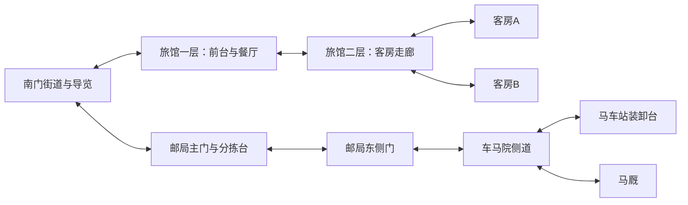
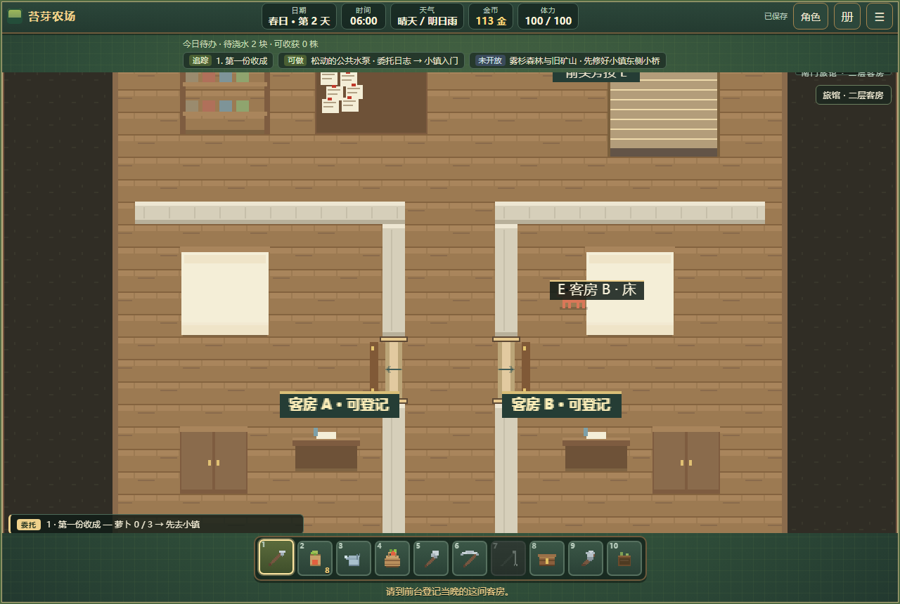
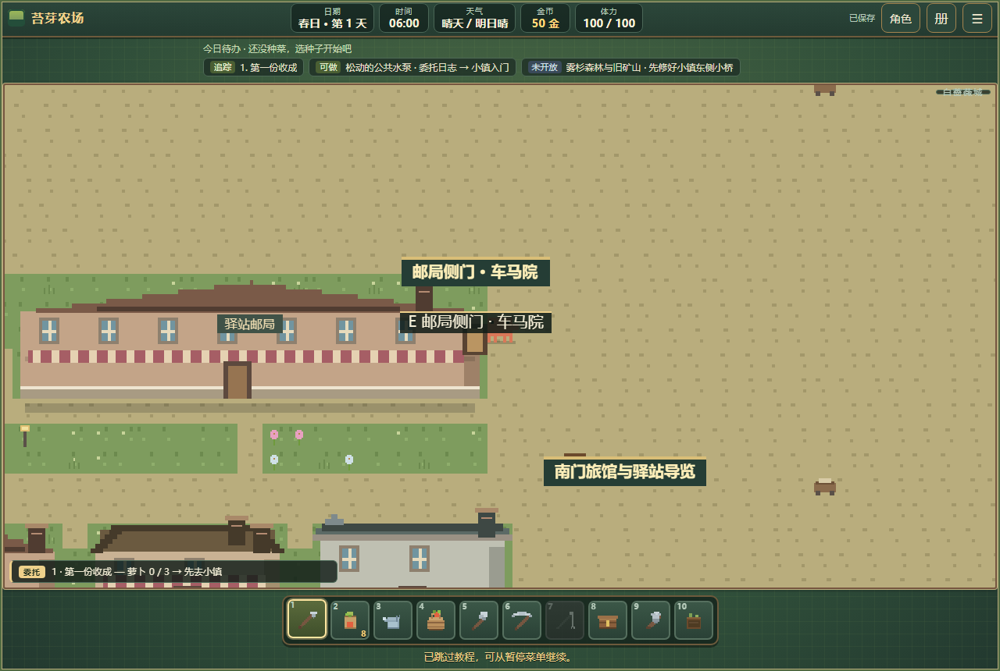

# 南门旅馆与驿站建设三期 · 客房、住宿和邮件交接

日期：2026-10-14。依据：[重点场景建设规划](重点场景建设规划-v1.md)建设三期。

## 本期建设

保留城市旅馆、邮局、马车站和马厩的建筑身份与原街道入口。旅馆由床和楼梯陈设改为实际两层住宿；邮局增东侧门，车马院补通路、导览与站内邮件交接。

| 区域 | 本期可用内容 |
|---|---|
| 旅馆一层 | 贝尔前台登记／取消住宿、购买面包，餐厅、行李区、自用料理厨房；右上方楼梯通二层 |
| 旅馆二层 | 两间实际客房 A、B，房门、床、衣柜、书桌、客房走廊及清洁储物架 |
| 邮局 | 原寄信柜台保留；新增分拣操作，原主门与东侧车马院门可双向往返 |
| 马车站 | 原付费街区交通保留；装卸台增邮件交接与回执 |
| 车马院与街道 | 指路牌、座椅、邮局侧道及连通路，通往旅馆、邮局、马车站和马厩 |
| 马厩 | 饮水槽、草料、马具及参观说明；本期未开放买马、寄养或独立货运系统 |

旅馆外观标为两层。原一层床位移除，留出餐饮与行李空间；二层客房采用连续走廊与真实门洞，门牌显示“可登记”或“已登记”，不反复传送进小房间。

## 楼梯、门与导览

旅馆一层上行平台 `(24,6)`，二层下行平台 `(21,3)`；上下层落点均为该层前厅 `(20,7)`，与反向触发点保持距离。按电脑 `E` 或手机“交互”切楼层，连按不会自动反弹。

二层为 30×24 格，北侧前厅通中央走廊，左右分别为客房 A、B。外墙保持完整，通过内部楼梯返回一层。客房门牌避开床和家具的遮挡。

邮局保留原主门；新增室内东侧门 `(25,14)`，室外门与建筑东墙对应，返回落点 `(287,438)`。门框、交互站位与方向牌一并绘制。侧道连接车马院，玩家可沿实际街道往返马车站。

旅馆、邮局、马车站及马厩的区域牌可打开南门导览；街道另有可交互指路牌。导览说明住宿状态、上次住宿记录、邮件下一步和原交通业务。

## 住宿规则

1. 到前台登记客房 A 或 B，支付当晚房费 **40 金**。一个玩家当晚只登记一间，已有登记时不再提供重复收费入口。
2. 未使用且仍在当日的登记，可在前台取消，退回原房费。取消后清空登记，不能重复退款。
3. 上二层找到登记房间，在床旁确认睡觉。未登记或房间不符时不能过夜；取消睡觉确认不推进日期，也不取消已有登记。
4. 过夜沿用原日结算：作物、出货、天气、地区事务、补助与恢复规则照常执行。未浇水作物不会被旅馆自动照料。
5. 次日在登记房间床旁醒来，保存住宿记录，释放当晚登记；确认过夜时不再收费。继续住下一夜须重新登记。

若没有从已登记床旁确认住宿，原农舍睡觉与其他日结算返回规则不变。当晚登记随日期结束过期，不自动续费；旧登记不能用来再睡或退款。价格、取消与醒来位置均在前台和确认窗口说明。

旅馆厨房复用已有料理配方与背包规则，前台另售乡村面包 30 金；没有新建第二套烹饪或物品价格系统。

## 站内邮件与回执

| 步骤 | 地点 | 时间／体力 | 结果 |
|---|---|---|---|
| 分拣领袋 | 邮局分拣台 | 10 分钟、1 体力 | 登记一袋在途站内邮件 |
| 交接 | 马车站装卸台 | 5 分钟 | 邮袋转为同一事务的回执 |
| 结清 | 回邮局分拣台 | 5 分钟 | 收回回执，支付 20 金 |

邮件和回执共用唯一阶段，存于事务记录中，不进入可出售背包。未完事务跨日与读档保留；每天最多结算一次，按实际结清日计算。完成后当天不能再领袋，次日可再办一轮。

该样板是城内邮局与马车站的交接工作，不等于跨地区包裹或全套邮政制度。原寄给诺尔的信与原街区马车价格、耗时继续使用，地图快速传送规则未改。

## 存档与验证

`southGate` 保存当晚登记、上次住宿、邮件阶段和结清日。旧档补空记录；过期登记清除。二层客房位置可读档恢复，旅馆等室内的墙内或家具内落点会移到附近可走格。

专项：[run-south-gate.mjs](../tests/run-south-gate.mjs)，源码与单文件版各 **56 项通过，共 112 项**。包含四处建筑与操作站位连通、真实街道往返、两种客房登记、钱不足、取消退款、唯一收费、错房拒绝、确认取消、在房内醒来、作物与出货、读档、邮局侧门、邮件回执、跨日与重复结算、旧档及归一化幂等、手机楼梯与导览。

专项用许可、金币、作物、出货和跨日夹具安排条件，通行、登记、住宿确认及邮件动作由实际输入完成。并非从全新存档自然完成城市通行的验收。

日结算相关复核：农场边界 **138 项**、完整主线 **123 项**、存档不变式 **11 项**、通用室内门 **19 项**及单文件冒烟 **6 项**通过；原城市服务复查无失败。最终邮局门与建筑对齐后另验证双向进出，标牌做视觉复核。

以下为运行时固定站位及登记状态的布局截图；它们用于观察房间、门牌与侧门排版。模拟手机结果与实体设备性能验证分别记录。

## 下一批

城市河港与工业区首轮已经完成，见[工业建设记录](industry-construction.md)；后续推进医舍及公共机构。

本批为本地工作区成果，单文件版和验证工作流已更新，尚未提交推送或发布线上。
