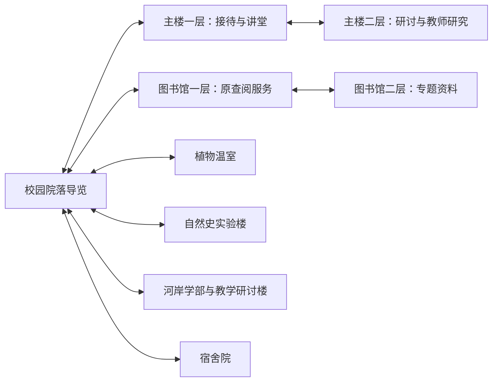
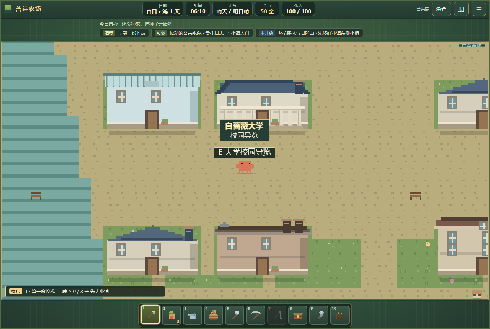
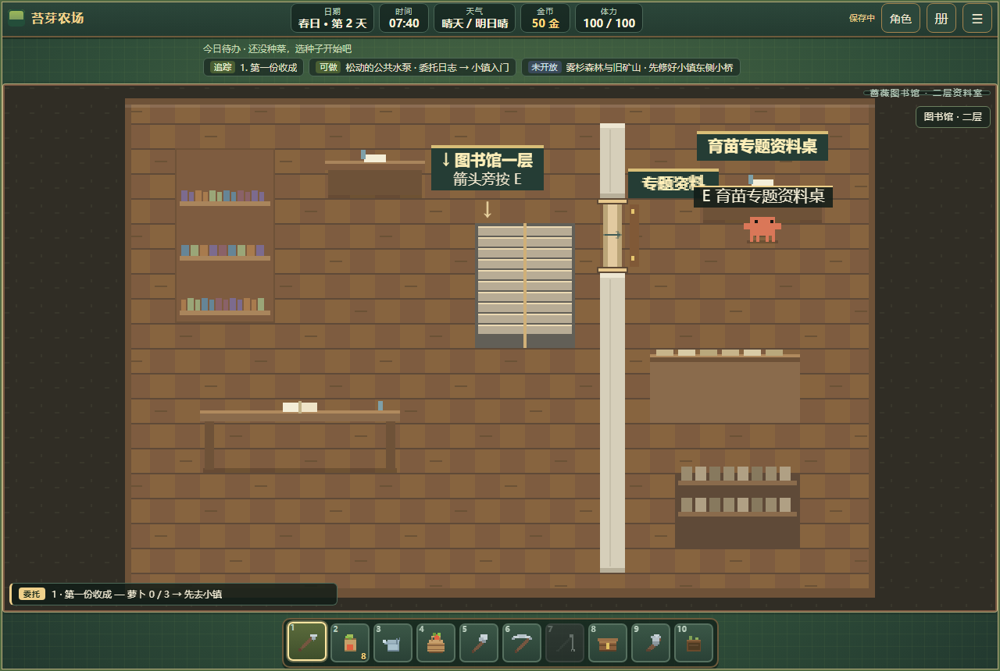
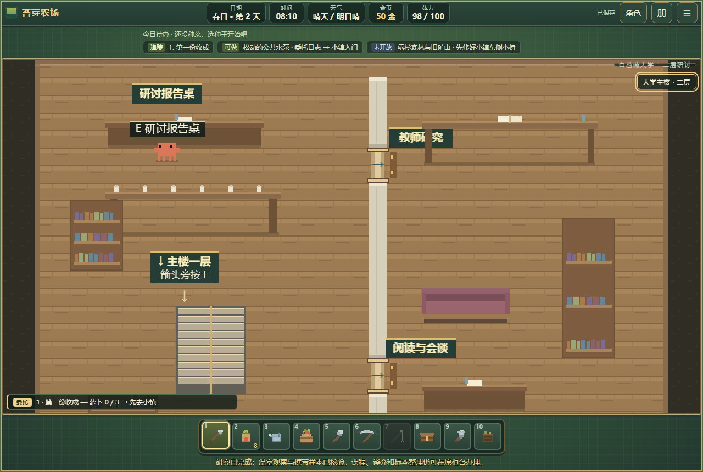

# 白蔷薇大学建设二期 · 校园、楼层与首轮研究

日期：2026-10-14。依据：[重点场景建设规划](重点场景建设规划-v1.md)建设二期。

## 交付范围

本期在现有城市校园内补院落铺装、连接路、座椅和导览牌，新增大学主楼二层与图书馆二层。城市尺寸、建筑外部门、马车落点、原服务与人物驻点保留。河岸学院作为河岸学部保留独立建筑，不替换大学主楼。

| 场所 | 当前用途 | 本期改造 |
|---|---|---|
| 校园院落 | 校内方向与休憩 | 七座既有建筑可从导览牌步行到达；铺路只改变空地地面，不清除建筑或树的碰撞 |
| 大学主楼一层 | 接待、课程、讲义与进阶课 | 增研究接待公告和通二层的西侧楼梯 |
| 大学主楼二层 | 研讨报告、教师研究、安静阅读与会谈 | 新建 36×24 格整层，房门在分隔墙上，报告桌有实际操作 |
| 图书馆一层 | 原查阅台、书架与旧志委托 | 保留服务；中央楼梯连接二层 |
| 图书馆二层 | 专题资料、安静阅览与档案 | 新建 30×20 格整层；专题资料桌可查阅育苗研究资料 |
| 植物温室 | 原育苗与相关服务 | 左侧种植床增研究观察点 |
| 自然史实验楼 | 原标本整理、考察与交易 | 增植物样本核验台 |
| 河岸学部、教学研讨楼、宿舍院 | 既有教学、译介及休整 | 纳入导览；本期未新增长期学制或宿舍入住制度 |

教师研究、阅览、档案及会谈空间提供环境和资料说明；长期导师课程、完整学期与额外学部为后续内容。

## 通行与楼层

- 图书馆一层中央梯段上楼，二层从梯段北侧下楼。上行平台 `(17,11)`、下行平台 `(14,4)`；落点分别为二层 `(16,12)` 与一层 `(16,3)`。
- 主楼一层西侧梯段上楼，二层从梯段北侧下楼。上行平台 `(11,20)`、下行平台 `(8,13)`；落点分别为二层 `(12,20)` 与一层 `(12,12)`。
- 四段楼梯均使用真实按键或手机“交互”，可双向返回，落点远离反向触发点。同层房门连续步行通过。
- 两个二层外墙保持封闭，通过内部楼梯返回；室内验收检查平台连通、目的落点和反向连接。
- 校园导览牌位于原大学院落；区域牌在大学相关室内常驻，可点开查看当前地点、楼层和研究下一步。主楼原课程窗口也提供导览入口。

教授砚秋、讲师允之、研究员墨笙和学员砚白保留原实体与活动位置，服务说明改为实际人物名称。

## 首轮学习研究：萝卜育苗观察

城市通行后可报名，不要求先完成其他职业或图书馆旧志故事。报名免费，样本核验需要背包里一份萝卜。

| 步骤 | 地点与动作 | 消耗和结果 |
|---|---|---|
| 报名 | 主楼一层研究接待公告 | 5 分钟；记录已报名 |
| 查阅 | 图书馆二层东侧育苗专题资料桌 | 20 分钟；记录资料已查阅 |
| 观察 | 温室左侧育苗床 | 10 分钟；记录现场观察 |
| 核验 | 实验楼植物样本核验台 | 萝卜 ×1、2 体力；基础 30 分钟，智力可缩短耗时，最多减少 15%，向上取整 |
| 报告 | 主楼二层左侧研讨报告桌 | 5 分钟；考察笔记 ×1、角色经验 60，经验受现有等级上限规则约束 |

本期研究为一次性完整样板。完成后可继续使用原课程、译介、标本整理和交易服务，研究奖励不能再次领取。限定矿样／水样的“专注研读”不套用于本次植物研究。

研究记录分别说明温室观察与携带样本核验；不宣称样本由玩家种植，也不把一次观察写成整个山谷的普遍规律。结论在校园导览保存，角色“经历”页提供研究进度与路线入口。

## 存档与结算

`university.studyStage` 保存报名、查阅、观察、核验和报告进度。旧档缺少该字段时补空研究；存档版本不变。研究支持跨日与读档，两个二层位置可安全恢复；大学室内落在家具上的旧位置会移到附近可走格。

动作使用统一行动接口：先检查许可、地点、阶段、时间、体力、材料与奖励空间，再扣除和推进。缺样本、时间不足、体力不足或错误阶段不推进；满包时报告仍待提交，笔记和经验均不先发。经验使用唯一来源 `university.seedling-report`，完成后不再显示领奖按钮。

## 验证范围

[run-university.mjs](../tests/run-university.mjs)在源码与单文件版各通过 54 项，共 108 项大学专项检查。包含校园院落至七座建筑的可达性、四段双向楼梯、从马车落点真实步行的完整研究路线、缺样本／时间／体力／满包处理、跨日、二层读档、唯一奖励、旧档及归一化幂等、手机上楼与导览。

专项使用城市许可、材料、时间体力、满包和跨日夹具安排条件，实际路段、门、楼梯和研究动作由真实输入完成；它不代表从新档自然办理整个城市通行流程。

补充复核：通用室内门 19 项、存档不变式 11 项、角色入口与手机 42 项、单文件冒烟 6 项均通过；原十五处城市服务及其人物检查通过。

原城市服务测试存在过期夹具，本期修正了课程测试指向错误楼、材料提示措辞、开窗前时间自然流逝，以及“满包”未占满／未使用当前木炭原料的问题。修正后仍检查真实扣料、满包拒绝与课程体力限制，未改动旧服务的生产或收费规则。

专项已加入统一验证入口与仓库验证工作流。最终标牌位置另做视觉复核，以下为固定站位及研究阶段的运行时布局截图；模拟手机验证与实体设备性能验证分别记录。

## 下一批

后续南门三期首轮已在本地交付，见[南门建设记录](south-gate-construction.md)。下一批推进河港与工业区；校园长期课程、宿舍入住和其他研究主题按规则准备程度另行扩充。

本批为本地工作区成果，单文件版已更新；提交推送与线上发布尚未执行。
