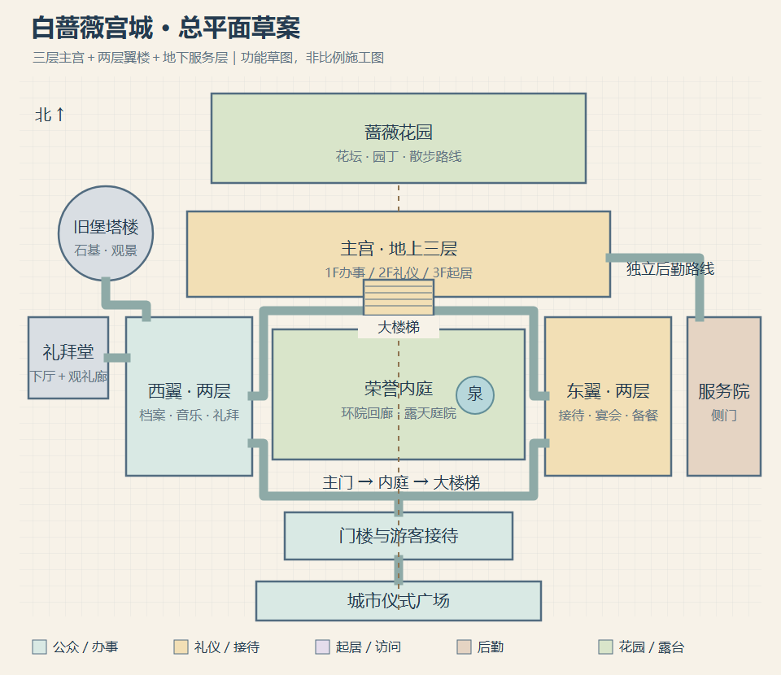

# 白蔷薇宫城施工规划

日期：2026-10-13。本文保留最初建筑方案及草图。2026-10-15 施工更新：主楼三层、东西翼两层、地下后勤、双层礼拜堂、旧堡展厅与观景层、花园维护均已在本地接入；当前范围及验证见[建设交付与复审](construction-completion.md)、[东翼记录](palace-east-wing.md)与[后勤楼层记录](palace-service-levels.md)。实际施工格网以游戏与交付记录为准，原功能草图不冒充竣工图。尚未推送或线上发布。

## 1. 设计目标

把现有城堡发展成可以逐层游览、办事和生活的宫殿建筑群。主体采用三层主宫、两层东西翼、地下服务层，配合旧堡塔楼、双庭院、礼拜堂、花园和局部露台。每层有明确用途，玩家沿真实门厅、走廊、楼梯和庭院到达。

外观继续使用白蔷薇城既有的暖白石墙、蓝灰屋顶和少量金色装饰。法国宫殿的对称主楼与长廊承担新宫部分，旧城堡和礼拜堂保留更早的石构、塔楼与拱券。建筑年代、功能和材料形成层次。

工作名称为“白蔷薇宫城”；游戏原有“白蔷薇城堡”名称和任务仍保留。宫殿参考皇家建筑的空间组织，主人称谓与行政权限沿用游戏世界观，不因扩建自动改变王国或领地制度。

## 2. 参考宫殿与具体借鉴

本次用 Exa 分四个方向检索20条候选结果，进一步读取6份官方资料。下表区分来源事实与游戏原创设计，未使用旅游营销页面作为建筑依据。

| 参考 | 官方资料能确认的空间特点 | 转化到本游戏 |
|---|---|---|
| 卢浮宫 | 官方地图显示三个相互连接的翼部与多个层级；原为王室居所，现为博物馆。[官方地图](https://api-www.louvre.fr/sites/default/files/2026-05/2026-05_Plan_Louvre_EN.pdf) | 连通的东西翼、围院回廊、肖像与历史画廊；让不同房间属于同一栋宫殿 |
| 凡尔赛宫 | 镜厅连接原先南北两侧的王室套房，临花园；官方导览将大套房与镜厅置于地面层上方一层。[镜厅](https://en.chateauversailles.fr/discover/estate/palace/hall-mirrors)、[楼层导览](https://bienvenue.chateauversailles.fr/en/palace/welcome) | 二层礼仪主层、面向花园的长廊、连续接待空间；前庭—主宫—花园的轴线 |
| 克里姆林宫 | 它是宫殿、教堂、广场与防御构筑物组成的建筑群；大克里姆林宫整合了旧宫殿与教堂，并包含礼仪厅、私人起居及服务空间。[宫城广场](https://kremlin-architectural-ensemble.kreml.ru/en-Us/architecture/view/ploshchadi-kremlya/)、[大克里姆林宫](https://kremlin-architectural-ensemble.kreml.ru/en-Us/architecture/view/bolshoy-kremlevskiy-dvorets-moskovskogo-kremlya/) | 保存旧堡塔楼与石基，礼拜堂、政务与主宫围绕庭院组合，呈现历代扩建 |
| 白金汉宫 | 国事厅用于正式接待与仪式；王座厅、舞厅、画廊功能不同，大楼梯构成到达仪式空间的重要序列。[官方空间介绍](https://www.rct.uk/visit/buckingham-palace/highlights-of-buckingham-palace) | 主楼梯、前厅、正式接待、宴会与画廊分工；接待路线和服务路线分开 |

这些资料支持建筑组织与房间用途；本方案的楼层、尺寸、房间位置、权限和任务都是针对游戏提出的原创取舍，不是四座真实宫殿的复刻。史料中的 first floor 在此理解为地面层上方一层，游戏统一标为一层、二层、三层。

## 3. 现有城堡基线

- 城市场景为640×480格。城堡地基在 (306,154)，28×10格；主入口由现有构造计算为 (320,164)，门外落点为 (320,165)。马车的城堡前庭站在 (320,178)。
- 室内 `city_castle` 为34×24格，现有王座、地毯、挂毯、雕像、等候座椅与管家接待，没有真实上楼连接。
- 现有城堡外观原型已标注三层主楼与两层侧翼；视觉层数尚未成为可通行楼层。
- 东西侧已有街墙与其他建筑。本次先保留城市主入口、道路与交通落点，通过门楼进入独立常驻宫苑地图，再展开完整建筑群，避免为了容纳宫殿先移动整片城区。
- 已有塞琳管家、园丁、城堡春宴供货与原有城市故事可继续使用。

以上来自本地 `game.js` 的 `CITY_ROOMS.castle`、城堡 building 调用、居民驻点与马车停靠配置；施工前应重新核对最终源码，防止并行开发改变入口事实。

## 4. 总平面：先经过院落，再进入宫廷

推荐游览次序：城市仪式广场 → 门楼与接待 → 荣誉内庭 → 主宫大楼梯 → 二层礼仪区 → 花园露台。东西翼围住内庭，背后的花园延续主轴；东侧后勤院另有货物入口，西侧旧堡塔楼与礼拜堂组成历史区。

宫苑建议初始120×96格，整层室内以约80×60格为排布上限，地下层可更紧凑。它们是布局测算起点，最终以房间、通道和手机视野验证调整，不直接写死成验收面积。

三层范围集中于主宫；两层翼部上方为部分屋面和可达露台。庭院上空保持开放，二层回廊不能变成跨院的一整块楼板。

## 5. 楼层与房间

### 地下层 B1：宫殿如何运转

厨房与炉灶、食材库、酒窖、维修间、旧堡石基展示。厨房位于宴会翼下方，经固定服务梯通往一层交货点及二层备餐侧门。粮食和修缮材料有实际收货、库存和委托用途；地下层不是必须战斗的迷宫。

### 一层 1F：公开办事与第一次到访

门厅、游客接待、文书与委托室、公开档案阅览、肖像前廊、卫兵值班、礼拜堂下厅、供货交接室。管家在办事区接待，农场供货在后勤侧门交接。大楼梯、内庭出口、花园方向与楼层导览在第一次进入时可见。

### 二层 2F：宫廷礼仪主层

王座厅、镜厅式长廊、正式接待厅、音乐沙龙、宴会厅、备餐间与礼拜堂上层观礼廊。王座厅保留现有核心陈设的比例和白蔷薇识别；长廊承担观看、等候和串联房间的用途，宴会厅有桌席、乐队位置与后勤门。

二层长廊与公开接待区应允许普通访客游览；正在进行的正式宴会或会议只限制相应房间，不封锁整层。

### 三层 3F：起居、阅读与访问

主人的书房与寝居、较小的私人会客室、客房、阅读廊和通往翼楼露台的入口。寝居是有门牌与许可条件的私密区域；客房、阅读与观景路线提供可到访内容，保证三层有实际探索空间。

这里比二层更安静，以木地板、壁炉、书桌、窗帘和较小家具表达生活尺度。正式接见、私下交谈和日常起居各有不同空间。

### 局部屋顶与旧塔：看见宫城的层次

翼楼露台和旧堡观景层可到达，能俯瞰内庭、花园或城市轮廓。屋面只开放有安全通路的部分；塔楼高度由画面表现，不为每一段塔身复制一张空楼层。

楼层草图：[B1](diagrams/palace-b1.png)、[一层](diagrams/palace-f1.png)、[二层](diagrams/palace-f2.png)、[三层](diagrams/palace-f3.png)。图中颜色表达功能分区，房间与连通位置仍需进入格网设计后复核。

## 6. 三套流线与楼梯规则

| 路线 | 主要经过空间 | 用途 |
|---|---|---|
| 公众路线 | 主门、门厅、内庭、文书／档案、礼拜堂、公开长廊 | 日常办事、第一次游览、既有任务 |
| 礼仪路线 | 大楼梯、等候前厅、正式接待、王座厅、镜廊、宴会厅 | 接见、故事、仪式与宴会 |
| 后勤路线 | 东侧货门、后勤院、地下厨房、服务梯、备餐间 | 供货、做饭、修缮；搬货不必穿过宴会中心 |

主楼梯在各层对齐，服务梯在宴会翼同一位置对齐；用可见台阶、栏杆和“上楼／下楼”提示交互。普通走廊与同层房门应连续步行，切楼层才加载对应层；进入每个普通房间不反复跳转到独立小盒子。

现有门的门洞、碰撞、提示和落点继续统一配置。新增内部楼梯需要明确的双向连接记录；室内验收应承认合法楼梯出口，不能为了满足旧的墙边门检查在高层外墙画一扇假门。

楼梯平台落点与触发格分开，防止刚上楼便自动下楼。门与楼梯旁保留至少2格通路，主要回廊3—4格，繁忙接待点避免家具堵路。二层临空庭院边设置可见栏杆与真实碰撞。

## 7. 房间的美术和生活内容

- 礼仪主层：大理石、长毯、墙面分格、吊灯、肖像与少量鎏金；镜廊使用固定高光与窗影，先不做实时镜面。
- 档案与政务：索引柜、借阅桌、封印、信件盘、值班时段与案件记录。
- 起居层：更小的家具、壁炉、窗帘、床边摆设、书桌与访客会面。
- 后勤：炉台、木架、食物库存、油灯、送货票据、修缮工具与服务梯。
- 礼拜堂与旧堡：石柱、拱券、历史石基、不同年代的纹章；保持统一像素尺度与光向。
- 庭院与花园：喷泉、花坛、树篱、散步路线和园艺委托；主体路线始终可辨，不让树冠遮住入口。

首轮以管家、书记员、厨师、卫兵、园丁和少量访客构成可见生活，不生成数百名NPC。每个角色有合理的工作位置，人物跨层活动要保持唯一实体和统一日程。

首个宫殿故事复用“蔷薇春宴”的人物与材料背景，串起一层收货、地下备料、二层布置与花园接待。已完成旧任务的玩家可接后续筹备，原奖不会重新发放。另安排公开档案查阅和花园／石材维护两类可反复事务。

楼层参观不要求加入军队或取得高阶职业。正式公务、寝居和特殊活动按具体许可检查；门牌写清谁能引荐及何时可进入。过夜只在明确登记的客房发生，不能走到陌生卧室自动睡觉。

## 8. 与现有城堡及存档衔接

施工建议保留 `city_castle` 的稳定身份，用作扩建后的二层礼仪主层；把原34×24王座核心嵌入较大的整层平面。新增一层入口接待与宫苑，不让旧城市大门直接跳进王座前。

旧存档中在城堡的玩家首次迁移到一层安全门厅，并保留任务、好感、供货和已取得许可。新增布局版本标记，坐标迁移只执行一次；原管家办理的事务仍可从一层找到。外部门、内部门、楼梯、交通站和NPC驻点应一起切换，不只移动画面。

推荐新增宫苑、地下、一层、三层和局部观景场景；二层沿用原ID。房间是层内区域，不按每个房间增加传送点。M地图保留一个宫城入口，宫内用楼层图显示房间、当前层、楼梯及可走路线。

渲染只运行当前层与有限人物，远处楼层按统一游戏日期保存。继续使用室内和地面缓存；不为多层体验改成实时3D。旧城堡委托与正在进行的其他职业开发保持各自事务账本。

## 9. 施工分期

| 批次 | 施工内容 | 玩家可验收的成果 |
|---|---|---|
| P1 多层骨架 | 宫苑入口、三层主宫、大楼梯、一层接待、二层王座与长廊、三层客房／阅读、局部露台 | 从城市主门进入，实际上到三层，再沿原路返回；每层有可访问内容 |
| P2 翼楼与后勤 | 东西翼、宴会与音乐空间、地下厨房仓储、服务梯、后勤院、礼拜堂双层关系 | 公开、礼仪和搬货三条路线成立；春宴供货能走完整空间链 |
| P3 宫城生活 | 花园、旧堡历史、人物日程、档案和维护后续、权限与反馈 | 做完任务仍能回访，有人物与服务回应已发生的事情 |
| P4 复审与发布 | 旧档、门梯连通、误触、手机、渲染缓存、原城堡任务与离线版 | 新旧档可用，双向楼梯不弹回，私密房间条件可查，发布版本一致 |

第一轮先交付P1，让三层真正可走；之后再把每层做得丰厚。此施工属于用户指定的城堡专项，可独立排入下一批，不强制先做完完整工程职业。

## 10. 施工验收清单

1. 从原城市入口进入宫苑，能辨认主宫、翼楼、旧堡、后勤院和花园方向。
2. 用真实键盘与手机控件上到二层、三层并下楼，落点和台阶朝向对应，不循环触发。
3. 同层房门、回廊与内庭连续可走；楼上不会穿过栏杆落到虚空或穿过家具。
4. 每个已开放层至少有可交互房间、可读陈设或生活事务；关闭区域有用途与开放条件。
5. 管家与既有城堡委托可找，已领取奖励不重复，旧档不会卡在被替换的墙或楼梯里。
6. 后勤可以从货门到厨房再到备餐间，不必穿过王座或宴会客席。
7. 新地图在手机横竖屏下门牌、楼梯按钮与楼层导航可读可点；性能以实际测量记录，不用房间注册数量替代。
8. 单文件版与正常入口都完成进出、跨层和读档验证；原有城市交通、R2战斗和职业事务回归正常。

本稿中的楼层图是游戏建筑功能草案，不是现实建筑的结构、消防或工程施工图。
